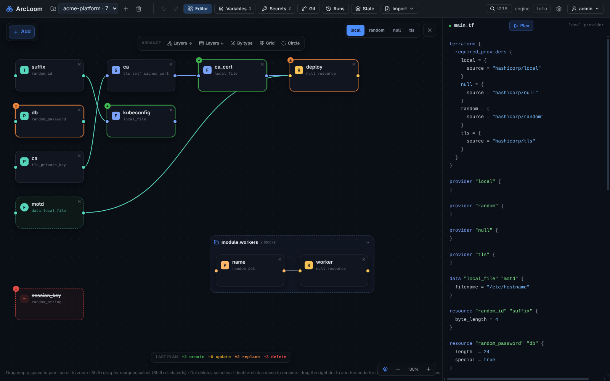
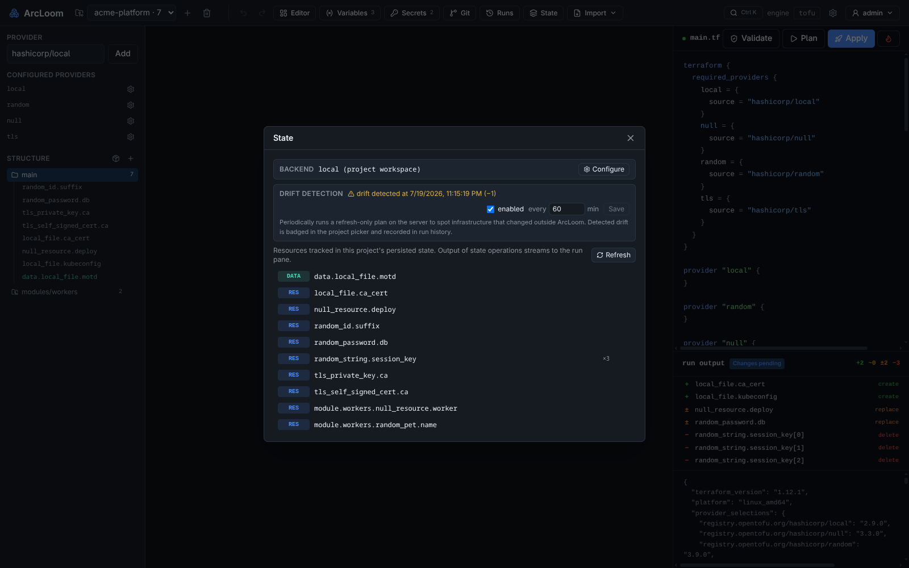
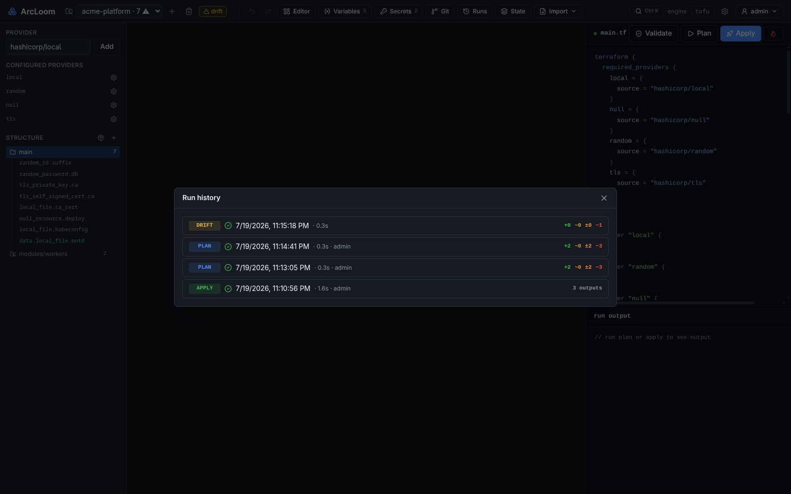
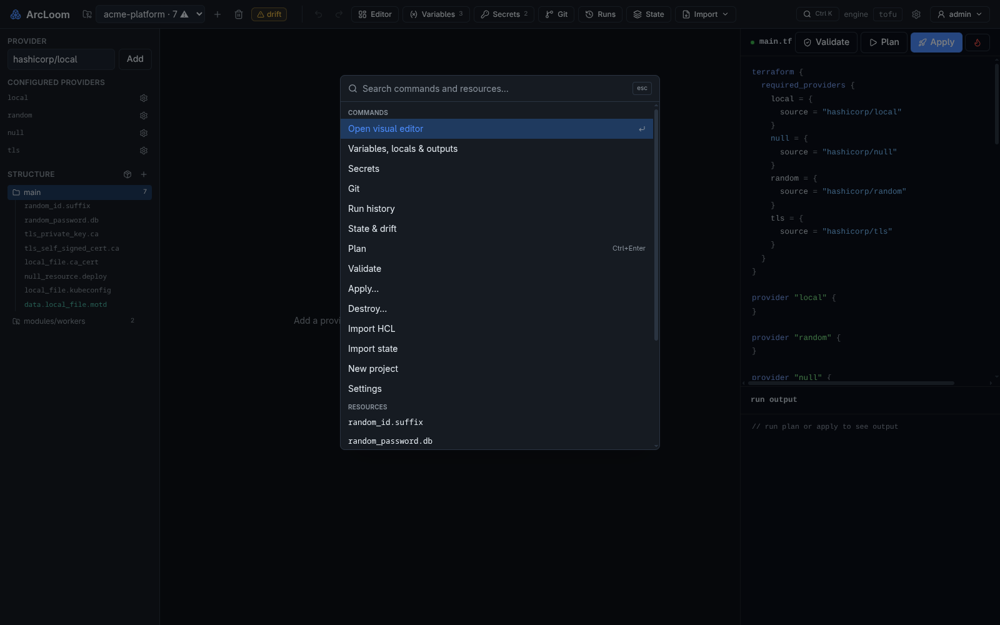

<div align="center">

# 🧵 ArcLoom

### Design your cloud infrastructure visually — without giving up your code.

ArcLoom is a self-hosted **Infrastructure IDE**. Drag, connect and configure your
resources on a canvas; ArcLoom writes clean, standard Terraform/OpenTofu for you.
No lock-in, no magic — the code it generates is yours to keep.

<br />


<sub>*The visual canvas on the left, the live infrastructure code on the right — always in sync.*</sub>

</div>

---

## What is ArcLoom?

If you've ever managed cloud infrastructure, you know the two usual options:

- **Write code by hand** (Terraform / OpenTofu) — powerful, but you memorize
  hundreds of settings, and one typo breaks a deploy.
- **Click around a cloud console** — friendly, but nothing is saved, reviewable,
  or repeatable.

**ArcLoom gives you both.** You build your infrastructure by pointing and
clicking on a visual map, and behind the scenes ArcLoom continuously writes the
real, industry-standard code. You can read it, review it, commit it to Git, and
run it anywhere — with or without ArcLoom.

> Think of it as a **design studio for your cloud**, where the design *is*
> working code.

## Who is it for?

- **Newcomers** who want to learn infrastructure without drowning in syntax.
- **Teams** who want a shared, visual picture of what they're running.
- **Experienced engineers** who like the speed of a UI but refuse to give up
  version control, reviews, and portable code.

## Main features

| | |
|---|---|
| 🧩 **Works with any provider** | AWS, Google Cloud, Azure, Cloudflare, Kubernetes, and thousands more. ArcLoom learns each provider's options automatically — nothing is hardcoded, so you're never waiting for "support" to be added. |
| 🎨 **A living map of your cloud** | Every resource is a node you can drag, connect and rearrange — including data sources, local modules (collapsible groups) and registry modules. Dependencies are drawn as lines, so you *see* how things fit together. |
| 📝 **The code stays yours** | ArcLoom generates plain Terraform/OpenTofu. Open it, take it elsewhere, or hand it to a colleague — no proprietary format, no lock-in. |
| 👀 **Preview, then deploy** | Run a "plan" and watch exactly what *would* change — as a colored overlay right on the map — then apply or destroy from the same screen, with confirmations where it matters. |
| 📡 **Drift detection** | ArcLoom can periodically compare your real infrastructure against what's deployed and badge the project the moment something changed behind your back. |
| 🕘 **Every run remembered** | Plans, applies, destroys, drift checks — each one is recorded with who ran it, the full log, the diff and the outputs. |
| 🔐 **Secrets stay secret** | API keys and passwords are encrypted and never written into your code, saved files, or history. |
| 🕓 **Built-in history** | Every project is version-controlled out of the box. Commit, browse history, compare changes, roll back — and push to GitHub/GitLab when you're ready. |
| ⌨️ **Fast to drive** | A Ctrl+K command palette finds any resource or action instantly; undo/redo, multi-select, marquee, snap-to-grid and inline rename make the canvas feel like a real editor. |
| 🏠 **Self-hosted & private** | Runs on your own machine or server, with local accounts, per-permission roles, and optional single sign-on. Your infrastructure details never leave your control. |

## How it works

A typical flow, start to finish:

1. **Create a project** and pick a provider (say, AWS or Cloudflare).
2. **Add resources** from a searchable menu — a server, a database, a DNS record…
3. **Fill in the form.** ArcLoom shows only the fields that resource actually
   has, and marks the read-only ones for you.
4. **Connect the dots.** Drag from one node to another to say "this depends on that."
5. **Watch the code write itself** in the live panel beside the canvas.
6. **Preview the plan** — every pending change is listed *and* drawn on the map.
7. **Apply it.** ArcLoom runs the deployment, streams the output, and records
   the run (with its outputs) in the project's history.
8. **Commit to history** and, when you're ready, push it to your Git host.

<div align="center">


<sub>*Pick any resource — or data source — from the provider's full catalog.*</sub>

<br />


<sub>*A guided form built automatically from the provider — no docs-hunting.*</sub>

</div>

## Organize your canvas your way

Big projects can get busy. ArcLoom's **Arrange** presets instantly re-lay-out the
whole map so you can read it at a glance:

- **Layers →** / **Layers ↓** — line resources up by what depends on what.
- **By type** — group all the servers, all the databases, etc.
- **Grid** — a tidy, compact overview.
- **Circle** — everything on a ring.

<div align="center">


<sub>*One click re-arranges the entire graph.*</sub>

</div>

## See every change before it happens

Run a plan and ArcLoom paints the result straight onto the map: green for new
resources, amber for updates, orange for replacements — and deleted resources
appear as dashed "ghost" cards so nothing disappears silently. The same diff is
listed in the run pane; click any line to jump straight to that resource.

<div align="center">


<sub>*The plan, drawn on your infrastructure map — with a summary legend.*</sub>

<br />


<sub>*The same changes as a list beside the streaming logs — click a row to open that resource.*</sub>

</div>

## Know when reality drifts

Infrastructure has a way of changing behind your back — someone deletes a file,
tweaks a server, removes a DNS record. Turn on **drift detection** and ArcLoom
periodically compares your real infrastructure against what you deployed, badges
the project the moment they disagree, and records what changed. The State view
also lists everything currently deployed, lets you rename or forget entries, and
can move the project's state to a remote backend (S3, GCS, Postgres, …).

<div align="center">


<sub>*Deployed resources at a glance — and a heads-up when something changed outside ArcLoom.*</sub>

<br />


<sub>*Every plan, apply and drift check is recorded — who, when, what changed.*</sub>

</div>

## Fast to drive

Press **Ctrl+K** anywhere to search every command and every resource across the
whole project — including inside modules. The canvas supports multi-select and
marquee selection, bulk move and delete, snap-to-grid, inline rename, and
undo/redo for every edit.

<div align="center">


<sub>*One shortcut to run anything or find any resource.*</sub>

</div>

## More screenshots

<div align="center">


<sub>*Every project keeps its own history you can browse and roll back.*</sub>

<br />


<sub>*Encrypted secrets that never end up in your code.*</sub>

</div>

## Already have infrastructure?

You don't have to start from scratch. ArcLoom can **import your existing setup**:

- Paste or upload your current Terraform/OpenTofu files — resources, data
  sources, variables, outputs, even modules — and ArcLoom rebuilds the visual
  map for you.
- Import a live state file to bring what you're *already* running onto the canvas.
- Adopt individual live resources by ID (`terraform import`), straight from the
  resource's form.

<div align="center">


<sub>*Bring your existing code or live state into ArcLoom.*</sub>

</div>

## Try it

The quickest way to take ArcLoom for a spin (requires [Docker](https://www.docker.com/)):

```bash
docker compose up -d
```

Then open **http://localhost:8080** in your browser.

### Sign in

ArcLoom requires a login by default. On first run it seeds an admin account from
`ARCLOOM_ADMIN_PASSWORD` (the bundled `docker-compose.yml` sets a dev value — log
in as **admin** and change it from the account menu). Useful settings:

| Variable | Default | Purpose |
|---|---|---|
| `ARCLOOM_ADMIN_PASSWORD` | — | Seeds the first admin on first run (ignored once a user exists). Required to start unless auth is disabled. |
| `ARCLOOM_ADMIN_USERNAME` | `admin` | Username for the seeded admin. |
| `ARCLOOM_AUTH` | `true` | Set `false` to disable auth entirely on a trusted network. |
| `ARCLOOM_SESSION_TTL` | `168h` | How long a login session stays valid. |
| `ARCLOOM_COOKIE_SECURE` | `true` | Set `false` to allow login over plain HTTP (no TLS). |

#### Single sign-on (OIDC)

Set these to add a "Sign in with SSO" button alongside local login (local stays
as a break-glass fallback). SSO users are provisioned on first login and linked
by their provider subject.

| Variable | Purpose |
|---|---|
| `ARCLOOM_OIDC_ISSUER` | Identity provider issuer URL, e.g. `https://oidc.example.com`. Enables SSO with `ARCLOOM_OIDC_CLIENT_ID`. |
| `ARCLOOM_OIDC_CLIENT_ID` / `ARCLOOM_OIDC_CLIENT_SECRET` | Registered app credentials. |
| `ARCLOOM_OIDC_REDIRECT_URL` | Callback registered with the IdP, e.g. `https://arcloom.example.com/api/auth/sso/oidc/callback`. |
| `ARCLOOM_OIDC_SCOPES` | Extra space-separated scopes (`openid` is always requested). |

If discovery fails at startup, ArcLoom logs a warning and continues with local login only.

## Project status

ArcLoom is **working today** and under active development. It already supports
multiple providers, projects, modules and data sources, plan/apply/destroy with
full run history, drift detection, state management with remote backends,
imports, secrets, role-based access, SSO, and built-in Git — with more on the
way. Feedback and ideas are very welcome.
