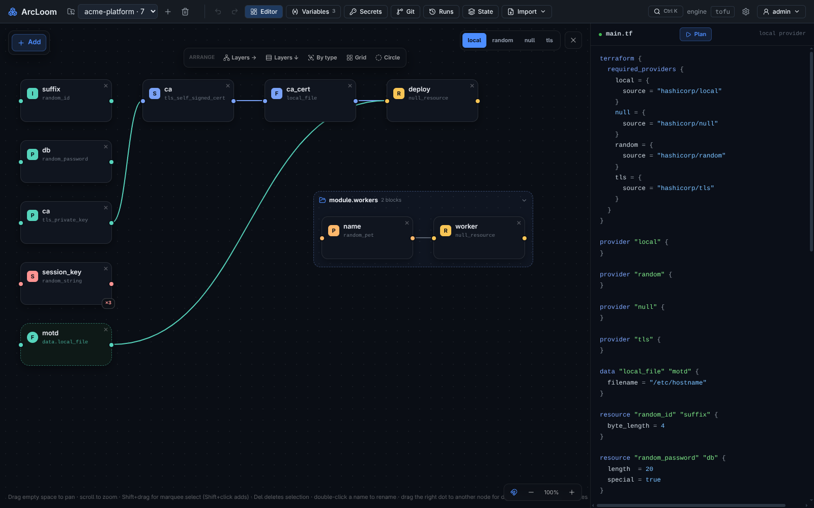
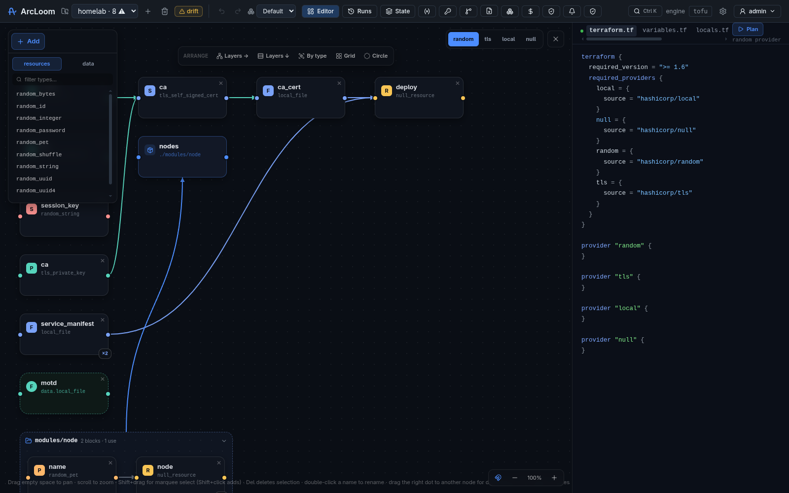
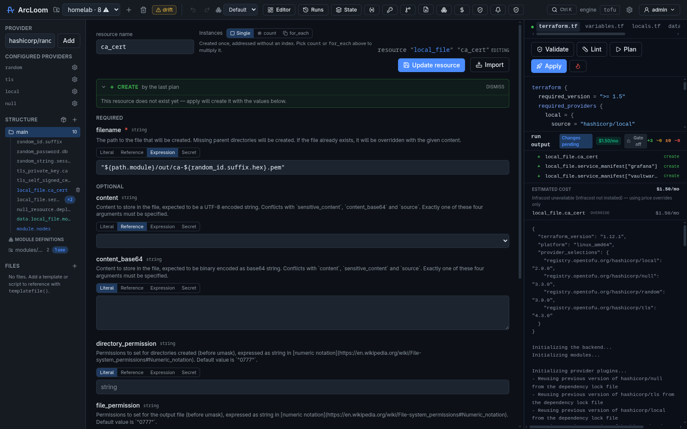
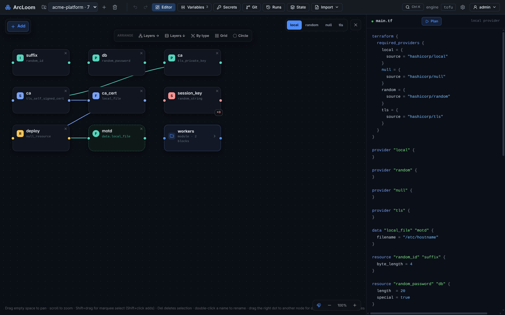
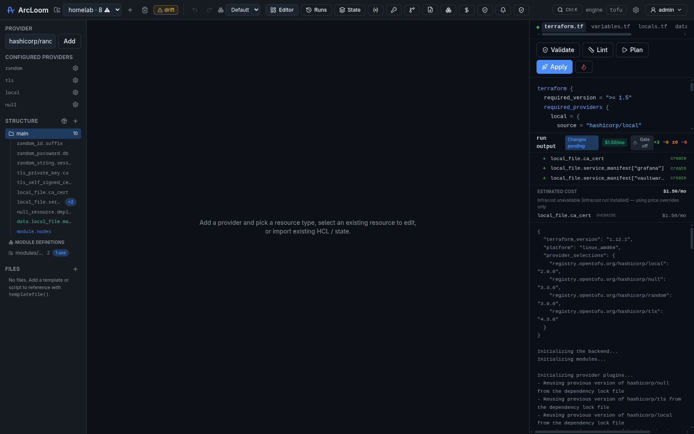
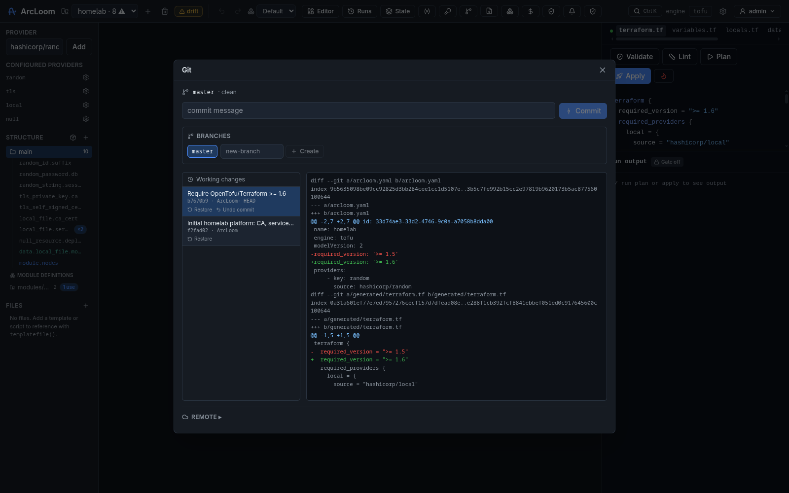
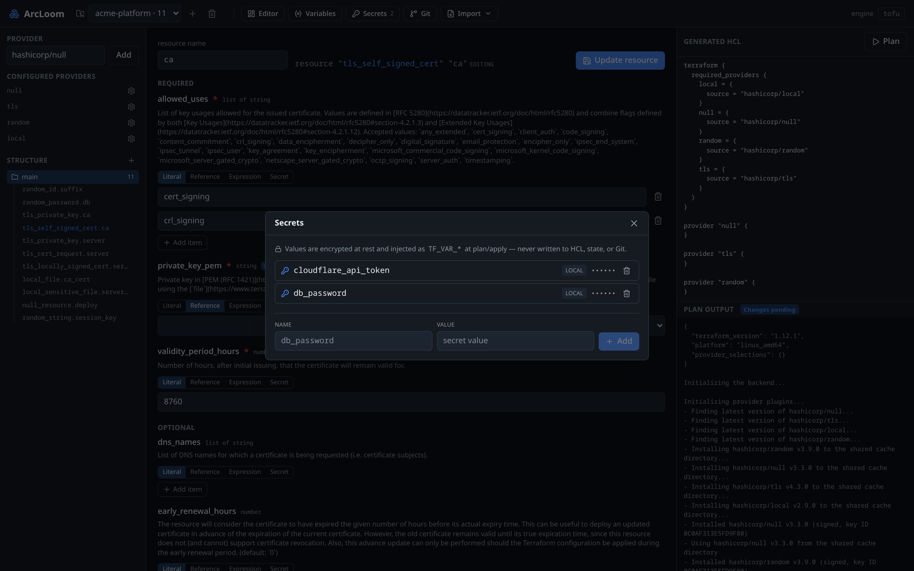
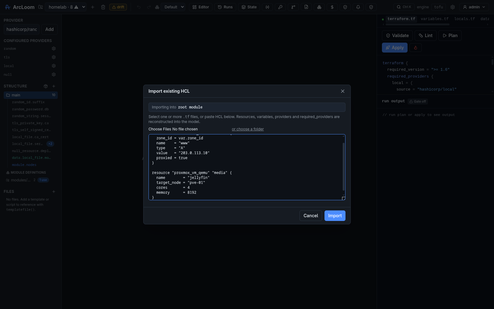

<div align="center">

# 🧵 ArcLoom

### Design your cloud infrastructure visually — without giving up your code.

ArcLoom is a self-hosted **Infrastructure IDE**. Drag, connect and configure your
resources on a canvas; ArcLoom writes clean, standard Terraform/OpenTofu for you.
No lock-in, no magic — the code it generates is yours to keep.

<br />



<sub>*The visual canvas on the left, the live infrastructure code on the right — always in sync.*</sub>

</div>

---

## What is ArcLoom?

If you've ever managed cloud infrastructure, you know the two usual options:

- **Write code by hand** (Terraform / OpenTofu) — powerful, but you memorize
  hundreds of settings, and one typo breaks a deploy.
- **Click around a cloud console** — friendly, but nothing is saved, reviewable,
  or repeatable.

**ArcLoom gives you both.** You build your infrastructure by pointing and
clicking on a visual map, and behind the scenes ArcLoom continuously writes the
real, industry-standard code. You can read it, review it, commit it to Git, and
run it anywhere — with or without ArcLoom.

> Think of it as a **design studio for your cloud**, where the design *is*
> working code.

## Who is it for?

- **Newcomers** who want to learn infrastructure without drowning in syntax.
- **Teams** who want a shared, visual picture of what they're running.
- **Experienced engineers** who like the speed of a UI but refuse to give up
  version control, reviews, and portable code.

## Why people like it

| | |
|---|---|
| 🧩 **Works with any provider** | AWS, Google Cloud, Azure, Cloudflare, Kubernetes, and thousands more. ArcLoom learns each provider's options automatically — nothing is hardcoded, so you're never waiting for "support" to be added. |
| 🎨 **A living map of your cloud** | Every resource is a node you can drag, connect and rearrange. Dependencies are drawn as lines, so you *see* how things fit together. |
| 📝 **The code stays yours** | ArcLoom generates plain Terraform/OpenTofu. Open it, take it elsewhere, or hand it to a colleague — no proprietary format, no lock-in. |
| 👀 **Preview before you touch anything** | Run a "plan" and watch exactly what *would* change, streamed live, before anything real happens. |
| 🔐 **Secrets stay secret** | API keys and passwords are encrypted and never written into your code, saved files, or history. |
| 🕓 **Built-in history** | Every project is version-controlled out of the box. Commit, browse history, compare changes, roll back — and push to GitHub/GitLab when you're ready. |
| 🏠 **Self-hosted & private** | Runs on your own machine or server. Your infrastructure details never leave your control. |

## How it works

A typical flow, start to finish:

1. **Create a project** and pick a provider (say, AWS or Cloudflare).
2. **Add resources** from a searchable menu — a server, a database, a DNS record…
3. **Fill in the form.** ArcLoom shows only the fields that resource actually
   has, and marks the read-only ones for you.
4. **Connect the dots.** Drag from one node to another to say "this depends on that."
5. **Watch the code write itself** in the live panel beside the canvas.
6. **Preview the plan** to see what would happen for real.
7. **Commit to history** and, when you're ready, push it to your Git host.

<div align="center">


<sub>*Pick any resource from the provider's full catalog.*</sub>

<br />


<sub>*A guided form built automatically from the provider — no docs-hunting.*</sub>

</div>

## Organize your canvas your way

Big projects can get busy. ArcLoom's **Arrange** presets instantly re-lay-out the
whole map so you can read it at a glance:

- **Layers →** / **Layers ↓** — line resources up by what depends on what.
- **By type** — group all the servers, all the databases, etc.
- **Grid** — a tidy, compact overview.
- **Circle** — everything on a ring.

<div align="center">


<sub>*One click re-arranges the entire graph.*</sub>

</div>

## More screenshots

<div align="center">


<sub>*See exactly what will change — before it changes.*</sub>

<br />


<sub>*Every project keeps its own history you can browse and roll back.*</sub>

<br />


<sub>*Encrypted secrets that never end up in your code.*</sub>

</div>

## Already have infrastructure?

You don't have to start from scratch. ArcLoom can **import your existing setup**:

- Paste or upload your current Terraform/OpenTofu files, and ArcLoom rebuilds
  the visual map for you.
- Import a live state file to bring what you're *already* running onto the canvas.

<div align="center">


<sub>*Bring your existing code or live state into ArcLoom.*</sub>

</div>

## Try it

The quickest way to take ArcLoom for a spin (requires [Docker](https://www.docker.com/)):

```bash
docker compose up -d
```

Then open **http://localhost:8080** in your browser.

### Sign in

ArcLoom requires a login by default. On first run it seeds an admin account from
`ARCLOOM_ADMIN_PASSWORD` (the bundled `docker-compose.yml` sets a dev value — log
in as **admin** and change it from the account menu). Useful settings:

| Variable | Default | Purpose |
|---|---|---|
| `ARCLOOM_ADMIN_PASSWORD` | — | Seeds the first admin on first run (ignored once a user exists). Required to start unless auth is disabled. |
| `ARCLOOM_ADMIN_USERNAME` | `admin` | Username for the seeded admin. |
| `ARCLOOM_AUTH` | `true` | Set `false` to disable auth entirely on a trusted network. |
| `ARCLOOM_SESSION_TTL` | `168h` | How long a login session stays valid. |
| `ARCLOOM_COOKIE_SECURE` | `true` | Set `false` to allow login over plain HTTP (no TLS). |

#### Single sign-on (OIDC)

Set these to add a "Sign in with SSO" button alongside local login (local stays
as a break-glass fallback). SSO users are provisioned on first login and linked
by their provider subject.

| Variable | Purpose |
|---|---|
| `ARCLOOM_OIDC_ISSUER` | Identity provider issuer URL, e.g. `https://oidc.example.com`. Enables SSO with `ARCLOOM_OIDC_CLIENT_ID`. |
| `ARCLOOM_OIDC_CLIENT_ID` / `ARCLOOM_OIDC_CLIENT_SECRET` | Registered app credentials. |
| `ARCLOOM_OIDC_REDIRECT_URL` | Callback registered with the IdP, e.g. `https://arcloom.example.com/api/auth/sso/oidc/callback`. |
| `ARCLOOM_OIDC_SCOPES` | Extra space-separated scopes (`openid` is always requested). |

If discovery fails at startup, ArcLoom logs a warning and continues with local login only.

## Project status

ArcLoom is **working today** and under active development. It already supports
multiple providers, projects, imports, secrets, and built-in Git — with more on
the way. Feedback and ideas are very welcome.
