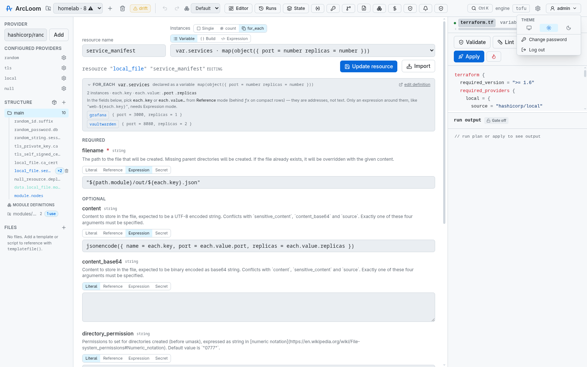
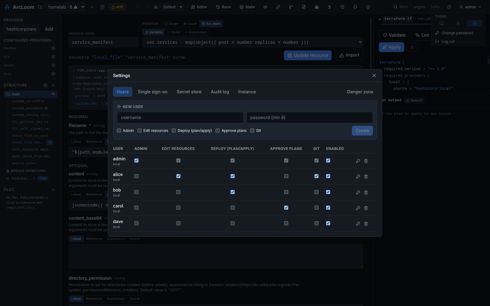
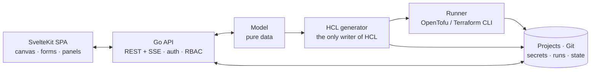

<div align="center">

# ArcLoom

### The self-hosted Infrastructure IDE for OpenTofu & Terraform

Design infrastructure on a canvas, review the HCL it writes, and plan, apply and
operate it — from one place you run yourself.

[](LICENSE)
[](go.mod)
[](#requirements)
[](#quick-start)

<br />


<sub>Your infrastructure as a graph on the left, the exact code that will run on the right.</sub>

</div>

---

## Why ArcLoom

Infrastructure work usually forces a trade: a cloud console is easy to explore
but leaves nothing behind, while HCL is reviewable and repeatable but demands
that you keep hundreds of provider arguments in your head.

ArcLoom removes the trade. You work on a canvas and in generated forms; ArcLoom
writes **standard, idiomatic HCL** split across the conventional files
(`terraform.tf`, `variables.tf`, `main.tf`, `outputs.tf`, …). That code is the
source of truth — commit it, review it, take it elsewhere, or stop using ArcLoom
entirely and keep everything you built.

|  | |
|---|---|
| **No lock-in** | Plain OpenTofu/Terraform on disk and in Git. ArcLoom reads it back too, so the round trip is real. |
| **No hardcoded providers** | Forms are generated from each provider's own schema, so every provider in the registry works the day it ships. |
| **No SaaS** | One Go binary with an embedded UI. Your state, secrets and credentials stay on your machine. |
| **No paid tier** | Apache-2.0, every feature. No license key, nothing gated. |

## Features

### Design

| | |
|---|---|
| **Visual canvas** | Drag, connect and group resources; dependency edges are drawn from the model. Multi-select, marquee, snap-to-grid, inline rename, per-node notes, five auto-layout presets. |
| **Schema-driven forms** | Every argument the provider declares, with its documentation, required/optional split and correct widget — including deeply nested blocks and dynamic attributes. |
| **Four value modes** | Any field can be a literal, a **reference** to another resource, a raw **expression**, or a **secret** — including inside lists, maps and objects. |
| **`count` / `for_each`** | A first-class Instances control with a collection browser: pick a `var.`/`local.`, build the collection in a structured editor, or write the expression. Instances expand into real rows. |
| **Modules** | Local module definitions and calls are separate concepts, as in HCL: one definition can back several calls, or none. Registry modules too. |
| **Variables, locals, outputs** | Edited as typed structures, not text — `object({...})` types drive the editor. |
| **Companion files** | Cloud-init templates, scripts and policy documents live in the project and are written next to the HCL for `file()` / `templatefile()`. |

### Deploy & operate

| | |
|---|---|
| **Plan / apply / destroy** | Streamed live, with a structured per-resource and per-attribute diff — not just a wall of log. |
| **Plan overlay** | Pending changes painted onto the canvas: colour-coded nodes, badges, and dashed ghost cards for planned deletes. |
| **Validate & lint** | `validate` plus **tflint**, both as first-class runs. |
| **Run history** | Every plan, apply, destroy, drift check and state operation recorded — who, when, the full log, the diff, the outputs. |
| **State management** | Browse state by module and instance; `mv`, `rm`, `taint`, `untaint`, force-unlock, bulk move, and refresh-only "accept drift". |
| **Remote backends** | S3, GCS, azurerm, pg, kubernetes, consul, http, oss, cos, remote — configured in the UI, with backend values that can come from secrets. |
| **Drift detection** | A scheduled plan that reports what an apply *would* change, and separates configuration edits from what changed outside ArcLoom. |
| **Environments** | Promote one configuration to `staging`, `prod`, … Each gets its own workspace, state and variables. |
| **Cost estimation** | Flat-price overrides per type or address, plus **Infracost** for real cloud pricing when installed. |
| **Adopt what exists** | Import HCL files or folders, import a live state file, `terraform import` per instance, or generate `import` / `moved` blocks. |

### Collaborate & govern

| | |
|---|---|
| **Built-in Git** | Every project is a repository: staged commits, branches, fast-forward merge, diffs, restore, undo commit, push/pull with stored credentials. |
| **Approval gate** | Optional plan → approve → apply: the approved plan artifact is the one that runs, and it is single-use. |
| **Policy as code** | Rego policies evaluated with **conftest** against the plan. Advisory, or enforced so a failing plan cannot be applied. |
| **Accounts & roles** | Local accounts (argon2id) or **OIDC SSO** with group → role mapping. Permissions: resources, deploy, approve, git, admin. |
| **Per-project access lists** | Restrict a project to named users; effective access is the intersection with their global permissions. |
| **Audit log** | Every mutating action, with actor and target. |
| **Notifications** | Apply outcomes and drift to Slack, Discord, Teams, Matrix, ntfy, Fluxer or a plain webhook. |
| **Secrets** | AES-256-GCM on disk, `ARCLOOM_SECRET_*` environment secrets, or **Vault / OpenBao**. Injected as `TF_VAR_*` at run time — never written to HCL, state or Git. Master key rotatable. |

## A closer look

<div align="center">


**Start empty, or adopt what you already run.** Every resource *and* data source
a provider offers is one search away — and existing HCL, whole folders, or a live
state file come in as a first-class import.

<br />


**Forms built from the provider's schema.** Documentation inline, the plan's
verdict for this resource at the top, and a mode switch on every field.

<br />



**`for_each` you can actually see.** ArcLoom resolves the collection, names the
keys, previews each member and lists the attributes `each.value` carries.
*(Light and dark themes throughout.)*

<br />


**The plan, on your map.** Green creates, amber updates, orange replacements,
dashed ghosts for deletes — with a summary legend.

<br />


**The same plan as data.** Per-resource actions, attribute-level diffs, cost, and
the streaming log beside them. Click any row to jump to that resource.

<br />


**State and drift.** What is really deployed, grouped by module and expanded per
instance — and a badge the moment reality disagrees with your configuration.

<br />


**History and secrets.** Every run kept with its diff and log; secrets grouped
into a tree, encrypted at rest, revealed only on request and only to users who
could already change them.

<br />




**Git and access control**, both built in.

<br />


**Ctrl+K** finds any command or any resource in the project, modules included.

</div>

## How it fits together

Each layer is replaceable, and the UI never touches HCL directly.



Optional tools are detected at startup and degrade gracefully when absent:
`tflint` (lint), `conftest` (policy), `infracost` (cloud pricing), `git`.

## Quick start

### Docker

```bash
docker compose up -d
```

Open **http://localhost:8080** and sign in as `admin` with the password from
`ARCLOOM_ADMIN_PASSWORD` in `docker-compose.yml` (change it on first login).
The image bundles OpenTofu, Terraform, tflint and conftest.

### Binary

```bash
make build     # builds the SPA, embeds it, compiles ./arcloom
./arcloom
```

### From source

```bash
make dev-api   # Go API on :8080
make dev-web   # Vite dev server on :5173, proxying /api
```

### Requirements

`tofu` or `terraform` on `PATH`. Everything else is optional.

## Configuration

All configuration is environment variables; sensible defaults apply throughout.

| Variable | Default | Purpose |
|---|---|---|
| `ARCLOOM_ADDR` | `:8080` | Listen address. |
| `ARCLOOM_ENGINE` | `tofu` | Default engine (`tofu` or `terraform`); projects may override. |
| `ARCLOOM_DATA` | platform config dir | Project folders (`arcloom.yaml` + generated HCL + workspace). |
| `ARCLOOM_SECRET_KEY` | — | Master passphrase for the encrypted secret store. Without it, secrets can only come from the environment. |
| `ARCLOOM_AUTH` | `true` | Set `false` only on a trusted single-user network. |
| `ARCLOOM_ADMIN_PASSWORD` | — | Seeds the first admin on first run; ignored once a user exists. |
| `ARCLOOM_COOKIE_SECURE` | `true` | Set `false` to allow login over plain HTTP. |
| `ARCLOOM_SESSION_TTL` | `168h` | Session lifetime. |
| `ARCLOOM_LOG_LEVEL` / `ARCLOOM_LOG_FORMAT` | `info` / `text` | Structured logging (`json` for shipping). |

<details>
<summary>Paths, caches and OIDC</summary>

<br />

| Variable | Purpose |
|---|---|
| `ARCLOOM_SECRETS_DIR`, `ARCLOOM_RUNS_DIR`, `ARCLOOM_AUDIT_DIR`, `ARCLOOM_APPROVALS_DIR`, `ARCLOOM_USERS_DIR`, `ARCLOOM_SESSIONS_DIR`, `ARCLOOM_SETTINGS_FILE` | Where each kind of data lives; all default beside `ARCLOOM_DATA`. |
| `ARCLOOM_CACHE_DIR`, `TF_PLUGIN_CACHE_DIR` | Normalized provider schemas and shared provider plugins. |
| `ARCLOOM_VAULT_TOKEN` | Token for an external secret store, so no credential is persisted. |
| `ARCLOOM_OIDC_ISSUER`, `ARCLOOM_OIDC_CLIENT_ID`, `ARCLOOM_OIDC_CLIENT_SECRET`, `ARCLOOM_OIDC_REDIRECT_URL`, `ARCLOOM_OIDC_SCOPES` | Seed SSO on first run. After that it is editable in **Settings → Single sign-on**, including group → role mapping. |

SSO sits alongside local login rather than replacing it, so an IdP outage never
locks you out. If discovery fails at startup ArcLoom logs a warning and
continues with local login.

</details>

`GET /healthz` and `/livez` are public and dependency-free for probes.

## Security posture

Worth knowing before exposing ArcLoom beyond your LAN:

- Sessions are **server-side opaque tokens** in an httpOnly, SameSite=Lax cookie — revocable, never JWTs in local storage.
- The resource, deploy, Git and admin route groups are CSRF-guarded, body-capped and permission-gated; the password endpoints are rate-limited *before* the hash runs, per IP and per account.
- Secrets are encrypted with an argon2id-derived key and injected only into the engine process. The master key can be rotated online or with the server stopped (`arcloom rekey`).
- Anything that becomes a filesystem path — project ids, file names, session tokens — is validated at the boundary.

## Status

ArcLoom covers the full workflow end to end today: providers, modules and data
sources; plan, apply and destroy with history; drift, state and remote backends;
imports; secrets; environments; approvals; policy; cost; Git; and RBAC, SSO and
auditing — each implemented and verified against a running engine.

Issues and ideas are welcome.

## License

[Apache License 2.0](LICENSE) — the whole repository, every feature. There is no
enterprise edition, no license key and nothing gated.
